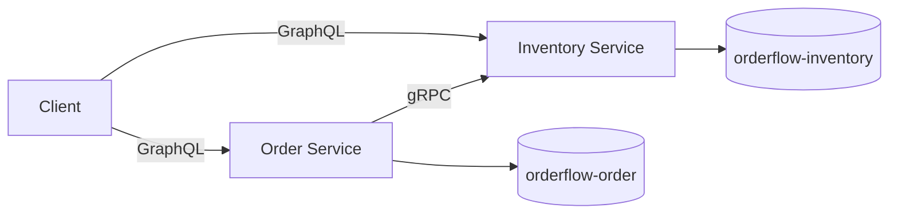
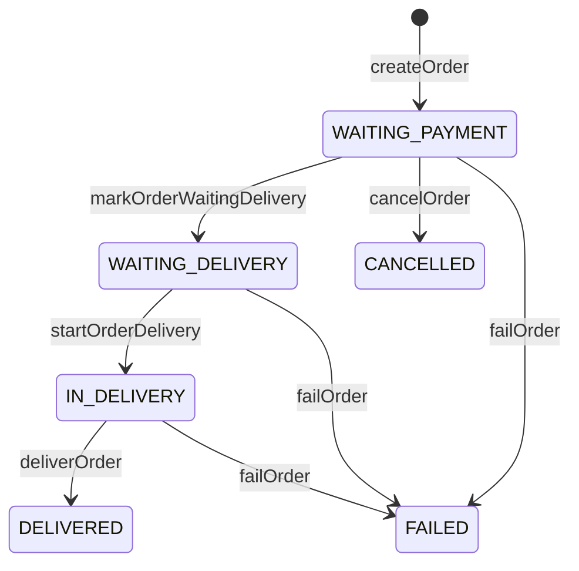

# OrderFlow - Order and Inventory Management System


OrderFlow is a Java 25 and Spring Boot 4 backend for managing products, stock, and customer orders. It follows a microservices architecture with separate GraphQL APIs for Inventory and Order, a PostgreSQL database per service, and synchronous gRPC for stock and pricing operations between them.

The project covers the order lifecycle from creation through delivery. It records the unit price on each item when the order is created, debits stock when the order moves to `WAITING_DELIVERY`, and returns stock if the order later fails.

## Quick Start

Start Docker Desktop in Linux container mode or run a Docker Engine with the Compose plugin. Clone the repository and start the stack.

```bash
git clone https://github.com/Lfav07/orderflow.git
cd orderflow
docker compose up -d --build
```

Wait for both services to finish starting. Compose waits for the databases to become healthy, and Inventory must be ready before Order can complete requests that call it.

```bash
docker compose ps
docker compose logs --tail=100 inventory order
```

Send GraphQL requests to Inventory on [localhost:8080/graphql](http://localhost:8080/graphql) and Order on [localhost:8081/graphql](http://localhost:8081/graphql). Follow the [API Testing](#api-testing) examples to create a product and place an order.

## Table of Contents

- [Architecture](#architecture)
- [Design Decisions](#design-decisions)
- [Application Flow](#application-flow)
- [Service Integration Flow](#service-integration-flow)
- [Infrastructure Overview](#infrastructure-overview)
- [Services](#services)
- [Technologies](#technologies)
- [Running the Project](#running-the-project)
- [API Testing](#api-testing)
- [Automated Tests and CI](#automated-tests-and-ci)
- [Future Improvements](#future-improvements)

## Architecture

Inventory owns the product catalog, available quantities, unit prices, and stock operation records. Order owns orders, their items, and delivery status. Clients send GraphQL requests directly to the service that owns the operation.



The main Java packages separate business rules from transport and database access.

- **Domain** defines models, state transitions, and repository interfaces.
- **Application** defines use cases and their input commands. Order also defines the gateway interface it uses to call Inventory.
- **Infrastructure** implements the GraphQL, gRPC, and JPA adapters.

## Design Decisions

- **Database per service.** Each service owns its schema and runs Flyway migrations on startup. Order references products by UUID across the service boundary.
- **Prices stored on order items.** Order fetches the current unit price from Inventory when creating each item and saves it with the quantity and line total. Prices and amounts use `BigDecimal`, and line totals round to two decimal places before being added to the order total.
- **Stock is debited on transition to delivery.** Order creation checks availability for each item, and orders awaiting payment can compete for the same stock. Inventory enforces the available quantity again when it applies each debit.
- **Optimistic locking.** Product and order persistence use JPA version fields to detect concurrent writes.
- **Compensation across service boundaries.** Inventory commits each stock change and its operation record in one local transaction. If a sequence of movements fails partway through or the Order transaction rolls back, Order attempts to reverse the movements it received confirmation for, in reverse order. If a response is lost or compensation itself fails, the services may require reconciliation.

## Application Flow

`createOrder` validates the items and calls Inventory via gRPC to check availability and retrieve the unit price for each product. It saves the order and its items in one local transaction and returns the initial status, `WAITING_PAYMENT`.



| Operation | Stock effect |
| --- | --- |
| `createOrder` | Checks availability for active products. |
| `markOrderWaitingDelivery` | Debits each item before saving the new status. The caller explicitly triggers this transition. |
| `startOrderDelivery`, `deliverOrder`, `cancelOrder` | Update order status only. Cancellation is limited to orders awaiting payment. |
| `failOrder` | Returns stock from `WAITING_DELIVERY` or `IN_DELIVERY`. From `WAITING_PAYMENT`, it updates the status only. |

## Service Integration Flow

Order uses blocking gRPC calls to Inventory. The two modules compile their own copy of the same wire contract, with generated classes in different Java packages.

| gRPC method | When Order calls it |
| --- | --- |
| `StockService.CheckStockAvailability` | During order creation to check the requested quantity against stock for an active product. |
| `ProductService.GetProductPrice` | During order creation to capture the unit price. |
| `StockService.DebitStock` | When moving to `WAITING_DELIVERY` or reversing a previously confirmed stock return. |
| `StockService.ReturnStock` | When failing an order whose stock was debited or reversing a previously confirmed debit. |

Quantities and prices are sent as decimal strings over gRPC to preserve precision. The [Inventory Protobuf contract](services/inventory/src/main/proto/inventory.proto) and the [Order client copy](services/order/src/main/proto/inventory.proto) define the request and response messages.

## Infrastructure Overview

Docker Compose builds both application images with Java 25 and starts two PostgreSQL 17 containers with persistent named volumes.

| Component | Compose service | Default host access | Compose network |
| --- | --- | --- | --- |
| Inventory GraphQL | `inventory` | `http://localhost:8080/graphql` | `inventory:8081` |
| Order GraphQL | `order` | `http://localhost:8081/graphql` | `order:8080` |
| Inventory gRPC | `inventory` | Internal to Compose | `inventory:9090` |
| Inventory PostgreSQL | `inventory-db` | Internal to Compose | `inventory-db:5432` |
| Order PostgreSQL | `order-db` | Internal to Compose | `order-db:5432` |

The default GraphQL endpoints are accessible without authentication and are intended for local development. Compose publishes the two HTTP ports and keeps gRPC and PostgreSQL on its internal network.

## Services

### Inventory Service

- Create products, change their names, descriptions, prices, and units, and activate or deactivate them.
- Look up products by ID and list or filter them by status, name, or unit.
- Query available quantity and adjust it with `increaseStock` and `decreaseStock`.
- Query stock operation records by ID or filter them by product and type. The gRPC debit and return flows write these records. Direct quantity changes through GraphQL update the product balance only.

[Source code](services/inventory) · [GraphQL schema](services/inventory/src/main/resources/graphql/product.graphqls) · [Database migrations](services/inventory/src/main/resources/db/migration)

### Order Service

- Create orders with one or more items, capturing unit prices and calculating totals.
- Look up an order by ID, list orders, or filter them by status. List and filter queries use zero-based pagination.
- Move orders through payment waiting, delivery preparation, delivery, cancellation, or failure using the lifecycle mutations.

[Source code](services/order) · [GraphQL schema](services/order/src/main/resources/graphql/order.graphqls) · [Database migrations](services/order/src/main/resources/db/migration)

## Technologies

- Java 25, Spring Boot 4.1.1, and Maven
- Spring for GraphQL and GraphQL Java Extended Scalars
- Spring gRPC and Protocol Buffers
- Spring Data JPA, Hibernate, PostgreSQL, and Flyway
- JUnit 6, Mockito, Testcontainers, and JaCoCo
- Docker and Docker Compose
- GitHub Actions and Jenkins

## Running the Project

### Docker Compose

The [Quick Start](#quick-start) runs the full backend with Docker. Set these variables in your shell or in a local `.env` file before starting Compose if you need to override the defaults.

| Environment variable | Default | Purpose |
| --- | --- | --- |
| `DB_USERNAME` | `orderflow` | PostgreSQL user for both services |
| `DB_PASSWORD` | `orderflow-local` | PostgreSQL password for both services |
| `INVENTORY_HTTP_PORT` | `8080` | Inventory GraphQL host port |
| `ORDER_HTTP_PORT` | `8081` | Order GraphQL host port |

PostgreSQL applies the credentials when it first initializes each volume. For existing volumes, update the database credentials before changing the values used by the applications.

Stop the stack with `docker compose down`. The named volumes keep the data for the next startup. See the [Docker Compose guide](docs/docker-compose.md) for more details.

### Running Locally

Install JDK 25 and Maven and start PostgreSQL on `localhost:5432`. Create two databases, `orderflow-inventory` and `orderflow-order`, and give the application user permission to run Flyway migrations and read and write their tables.

Set `DB_USERNAME` and `DB_PASSWORD` in both terminals. Use the default Spring profile and start Inventory first. Run each command in its own terminal from the repository root.

```bash
mvn -pl services/inventory spring-boot:run
```

```bash
mvn -pl services/order spring-boot:run
```

The host GraphQL URLs are the same as in Compose. Order defaults to `static://localhost:9090` for gRPC. Set `INVENTORY_GRPC_TARGET` in the Order process if Inventory is elsewhere, or `INVENTORY_GRPC_DEADLINE` to override the default deadline of `5s`.

## API Testing

Use Postman or any HTTP client to send `POST` requests to the service's `/graphql` endpoint. In Postman, choose **Body → GraphQL** and paste the operation. Check the response's `errors` array even when the HTTP request succeeds. Common application codes under `errors[].extensions.code` include `BAD_REQUEST`, `NOT_FOUND`, and `CONFLICT`. Order can also return `UPSTREAM_ERROR` when an Inventory call fails unexpectedly.

### Create a Product in Inventory

Send to `http://localhost:8080/graphql` and copy the returned product ID.

```graphql
mutation CreateProduct {
  createProduct(input: {
    name: "Coffee beans"
    quantityInStock: 10
    unit: UNITS
    pricePerUnit: 4.75
    status: ACTIVE
  }) {
    id
    quantityInStock
    pricePerUnit
  }
}
```

### Create an Order

Send to `http://localhost:8081/graphql` with the product ID from the previous response.

```graphql
mutation CreateOrder($productId: ID!) {
  createOrder(input: { items: [{ productId: $productId, quantity: 2 }] }) {
    id
    status
    totalAmount
    items {
      productId
      quantity
      unitPrice
    }
  }
}
```

```json
{ "productId": "<product ID>" }
```

The order starts in `WAITING_PAYMENT` with a total of `9.50`. Copy the order ID and use it for the next request.

### Move the Order to Waiting for Delivery

Send to `http://localhost:8081/graphql`.

```graphql
mutation MarkOrderWaitingDelivery($orderId: ID!) {
  markOrderWaitingDelivery(input: { id: $orderId }) {
    id
    status
  }
}
```

```json
{ "orderId": "<order ID>" }
```

The order moves to `WAITING_DELIVERY`. Query `availableStock` in Inventory with the product ID to verify that the quantity is now `8`. Continue with `startOrderDelivery` and `deliverOrder`, or call `failOrder` from `WAITING_DELIVERY` or `IN_DELIVERY` to return the two units.

For additional PowerShell requests, error cases, and persistence checks, follow the [Docker Compose manual test checklist](docs/docker-manual-tests.md).

## Automated Tests and CI

Run the unit and focused API tests from the repository root.

```bash
mvn test
```

For the complete Maven verification, start Docker and run Maven from the repository root.

```bash
mvn verify
```

- **Inventory** covers domain rules, application use cases, GraphQL and gRPC, and PostgreSQL persistence. Failsafe runs the integration suite with Testcontainers during `verify`. JaCoCo enforces 75% instruction and branch coverage and produces a report at `services/inventory/target/site/jacoco/index.html`.
- **Order** covers the domain, order creation and transitions, GraphQL controller behavior, JPA mapping, and the gRPC client.
- **GitHub Actions** runs `mvn -B clean verify` for each service in its own workflow and uploads test reports. [Inventory CI](.github/workflows/inventory-ci.yml) · [Order CI](.github/workflows/order-ci.yml)
- **Jenkins** provides an Inventory verification pipeline on an agent labeled `docker`. The Jenkins controller and agent definitions are commented out in the default Compose file. [Jenkinsfile](Jenkinsfile) · [Compose definition](docker-compose.yaml)

## Future Improvements

- Build a frontend for product management and order tracking.
- Integrate payment confirmation with the transition to `WAITING_DELIVERY`.
- Add authentication and authorization to the GraphQL APIs before exposing them outside local development.
- Add end-to-end CI coverage for the Order-to-Inventory workflow, including debit and return.
- Add durable retry and reconciliation for stock operations whose gRPC result is uncertain.
